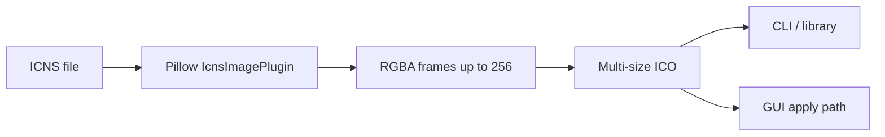

# Enable ICNS → ICO conversion on Windows

## Context

[`PhoFilesystemIconHelper`](c:\Users\pho\repos\PhoFilesystemIconHelper) has no conversion code today. Pillow is already declared in [`pyproject.toml`](c:\Users\pho\repos\PhoFilesystemIconHelper\pyproject.toml) but unused. Magico only does PNG → folder-style `.ico` via ImageMagick. Hundreds of `.icns` assets already live under `EXTERNAL/EXTRACTED_CUSTOM_ICONS`.

**Approach:** Pillow-only (no ImageMagick, no `iconutil`). Pillow reads ICNS and writes multi-size ICO on Windows; ICO entries are capped at 256×256.

## Implementation

### 1. Core converter module

Add [`src/phofilesystemiconhelper/icns_to_ico.py`](c:\Users\pho\repos\PhoFilesystemIconHelper\src\phofilesystemiconhelper\icns_to_ico.py):

- `icns_to_ico(src: Path, dest: Path | None = None, *, sizes=...) -> Path`
  - Open with `PIL.Image.open`; require `.icns` (or sniffable ICNS)
  - Collect native ICNS sizes from `im.info["sizes"]` (tuples `(w, h, scale)`), load each via setting `im.size` / scale before `load()`, keep RGBA frames ≤ 256×256
  - Save ICO with standard Windows sizes `(16, 24, 32, 48, 64, 128, 256)`, preferring native frames via `append_images` over Lanczos downscales of the largest
  - Default `dest` = same stem as `src` with `.ico` beside the source
- `batch_icns_to_ico(input_dir, output_dir, recursive=False) -> list[Path]` for library dumps
- Clear errors if Pillow cannot decode a given ICNS (e.g. unsupported codec)

### 2. Package + CLI surface

- Add missing [`src/phofilesystemiconhelper/__init__.py`](c:\Users\pho\repos\PhoFilesystemIconHelper\src\phofilesystemiconhelper\__init__.py) exporting `icns_to_ico`
- Add [`src/phofilesystemiconhelper/__main__.py`](c:\Users\pho\repos\PhoFilesystemIconHelper\src\phofilesystemiconhelper\__main__.py) argparse CLI:

```text
uv run python -m phofilesystemiconhelper icns-to-ico path\to\icon.icns [-o out.ico]
uv run python -m phofilesystemiconhelper icns-to-ico path\to\dir -o out_dir [--recursive]
```

- Register console script in [`pyproject.toml`](c:\Users\pho\repos\PhoFilesystemIconHelper\pyproject.toml): `phofilesystemiconhelper = "phofilesystemiconhelper.__main__:main"`

### 3. Thin GUI hook

In [`src/phofilesystemiconhelper/test.py`](c:\Users\pho\repos\PhoFilesystemIconHelper\src\phofilesystemiconhelper\test.py):

- Widen file dialog to `Icon Files (*.ico *.icns)`
- In `apply_icon`, if path ends with `.icns`, convert beside the source (or to a temp next to it) and use the resulting `.ico`

Do **not** rewrite the broken Win32 folder-apply path in this change; conversion is the deliverable.

### 4. Docs

Update [`README.md`](c:\Users\pho\repos\PhoFilesystemIconHelper\README.md) with a short “Convert ICNS → ICO (Windows)” section showing the CLI and noting Pillow handles this without ImageMagick (ImageMagick remains for magico only).

### 5. Smoke check

After implementation, convert one sample from `EXTERNAL/.../Icons/Mac/.../*.icns` and confirm the `.ico` opens and lists multiple sizes.


